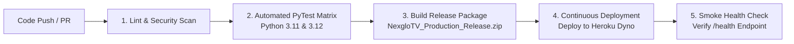

# NexgloTV WhatsApp AI Agent — CI/CD Pipeline Guide

This project includes a production-grade **Continuous Integration & Continuous Deployment (CI/CD)** pipeline automated via **GitHub Actions** (`.github/workflows/ci-cd.yml`).

---

## 1. Pipeline Architecture & Workflow Stages

Every time code is pushed to `main` or a Pull Request is submitted, GitHub Actions executes four stages:

### Stage 1: Code Quality & Security Check (`lint-and-security`)
- Runs syntax and static analysis via `ruff`.
- Verifies that all required deployment files exist and are valid (`Procfile`, `runtime.txt`, `app.json`, `data/schema.sql`).
- Fails fast if any syntax error or broken import is detected.

### Stage 2: Automated Test Matrix (`test`)
- Tests the complete test suite (207 tests) in parallel on **Python 3.11** and **Python 3.12**.
- Verifies:
  - AI Safety Guardrails & Jailbreak defenses (`tests/test_guardrails.py`).
  - Reseller Bot & Lark CRM Sync (`tests/test_reseller_bot.py`, `tests/test_reseller_lark.py`).
  - 16-Package Pricing Matrix & Quotations (`tests/test_nexglo_pricing.py`).
  - Conversational Sales & Trial Flow (`tests/test_nexglo_sales_flow.py`).
  - Heroku & BotKeep runtime readiness (`tests/test_heroku.py`, `tests/test_botkeep.py`).

### Stage 3: Release Artifact Packaging (`package-release`)
- Automatically builds a clean `NexgloTV_Production_Release.zip` without virtual environments, caches, temporary databases, or secrets.
- Uploads the ZIP as a GitHub Actions build artifact accessible directly from the GitHub repository summary.

### Stage 4: Continuous Deployment to Heroku (`deploy-heroku`)
- Triggered automatically on push to `main` once all tests pass.
- If Heroku credentials are configured in GitHub Secrets, deploys the code directly to your Heroku app.
- Runs a post-deployment smoke test against `https://<YOUR_APP_NAME>.herokuapp.com/health` to confirm the dyno is live.

---

## 2. Enabling Automated Heroku Deployments

The deployment job will gracefully skip until you add your Heroku credentials as GitHub Secrets:

1. **Get your Heroku API Key:**
   - Log into [dashboard.heroku.com](https://dashboard.heroku.com).
   - Click on your avatar (top right) $\to$ **Account settings**.
   - Scroll down to **API Key** $\to$ click **Reveal** and copy it.

2. **Add Secrets in your GitHub Repository:**
   - Go to your repository: `https://github.com/mcdowellsjohn07/nexglo-ai-wa`.
   - Click **Settings** $\to$ **Secrets and variables** (in the left sidebar) $\to$ **Actions**.
   - Click **New repository secret** and add:
     - `HEROKU_API_KEY`: *(paste your Heroku API key)*
     - `HEROKU_APP_NAME`: *(your Heroku app name, e.g. `nexglotv-wa-ai`)*

Once these two secrets are added, every commit you push to `main` will automatically test, build, and deploy straight to Heroku!

---

## 3. Manual Deployment Trigger

You can also trigger a deployment or test run manually at any time:
1. Go to the **Actions** tab in your GitHub repository.
2. Select **NexgloTV CI/CD Pipeline** on the left.
3. Click the **Run workflow** button on the right $\to$ click **Run workflow**.
