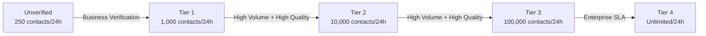
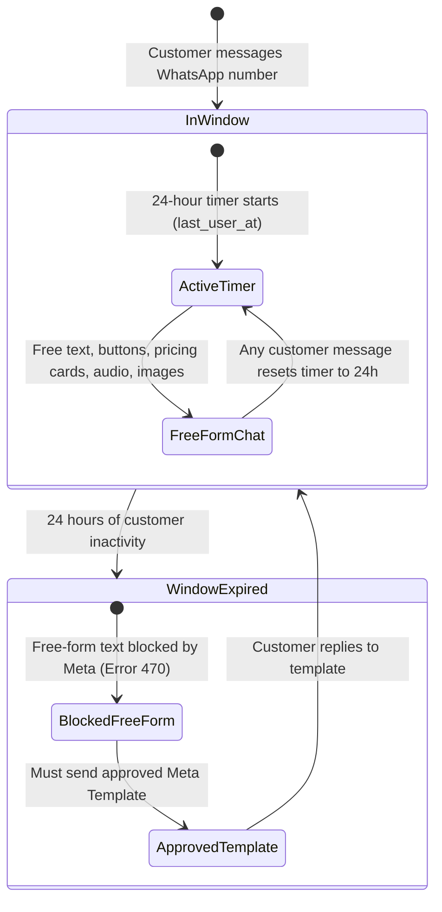

# Meta WhatsApp Cloud API — Limits, Quotas & Utilization Strategy

This guide provides an end-to-end operational blueprint on Meta WhatsApp Cloud API limits, pricing tiers, throughput quotas, and actionable strategies to maximize conversion and minimize costs for NexgloTV.

---

## 1. Executive Summary

| Metric | Meta Cloud API Specification | NexgloTV Implementation |
|---|---|---|
| **Inbound Customer Messages** | **Unlimited** (at any tier) | 100% captured via `/webhook` with zero per-message cost |
| **Free Monthly Allowance** | **1,000 Service conversations/month** | Inbound leads chatting with AI or staff consume the free tier first |
| **Outbound Messaging Tiers** | 250 → 1,000 → 10,000 → 100,000 / 24h | Governs proactive business-initiated template broadcasts |
| **API Throughput** | **80 messages per second (mps)** | Async FastAPI + keep-alive HTTP ensures response in < 500ms |
| **Service Window** | **24 hours** from customer's last message | Persisted in Turso DB (`last_user_at`) across all deploys & restarts |
| **Webhook SLA** | Must respond **`HTTP 200 OK` in < 20s** | Handled asynchronously with `processed_messages` deduplication |

---

## 2. Meta Messaging Tier System (Outbound Broadcasts)

Meta restricts how many **unique customer phone numbers** your business can initiate conversations with in a rolling 24-hour window using pre-approved templates.

### Tier Structure

1. **Unverified / Sandbox Tier (250 contacts / 24h):**
   - The default state before Meta Business Verification is approved.
   - You can message up to 250 unique numbers in a rolling 24-hour window.
2. **Tier 1 (1,000 contacts / 24h):**
   - Unlocked once Meta Business Verification is completed and a payment method is added.
3. **Tier 2 (10,000 contacts / 24h):**
   - Unlocked automatically when you initiate chats with $\ge 500$ unique contacts within 7 days while maintaining a **High (Green)** or **Medium (Yellow)** phone quality rating.
4. **Tier 3 (100,000 contacts / 24h):**
   - Unlocked when messaging $\ge 5,000$ unique contacts within 7 days with clean quality.
5. **Tier 4 (Unlimited contacts / 24h):**
   - Enterprise scale.

> [!IMPORTANT]
> **Tier limits do NOT restrict incoming customer chats.** If 5,000 customers click your WhatsApp link and message your bot today, the bot can reply to all 5,000 customers without hitting any tier ceiling.

---

## 3. The 24-Hour Customer Service Window

WhatsApp strictly divides communication into **In-Window** and **Out-of-Window**:

### In-Window (Customer-Initiated / Service)
- When a customer messages your number, a **24-hour service window** opens.
- Any reply sent by NexgloTV AI or staff within this window is **free-form** (custom text, interactive buttons, list menus, images, payment guides).
- Every new message received from the customer **resets the 24-hour clock**.
- **Pricing:** The first **1,000 service conversations every calendar month are 100% free** from Meta.

### Out-of-Window (Business-Initiated)
- Once 24 hours elapse since the customer's last message, Meta **blocks free-form text**. Any standard text message sent will fail with Meta API error `470` or `131047`.
- To re-engage, you must send an approved **Meta Message Template** (Marketing, Utility, or Authentication).
- When the customer replies to your template, a new 24-hour free-form service window re-opens.

### How NexgloTV Enforces and Persists This
- `conv.last_user_at` is stored in the persistent **Turso Cloud DB**.
- The staff console displays:
  - `🟢 24h Window Active (Closes: YYYY-MM-DD HH:MM:SS)`
  - `⏳ 24h Window Closed (X.X h ago)`
- If a staff member attempts to send a free-form message to an expired contact, the system prevents it with an explanation and directs staff to send a template instead of triggering Meta API errors.

---

## 4. Technical Throughput & Payload Quotas

### Throughput Speed
- **Baseline Speed:** **80 messages per second (mps)** for Cloud API.
- Can be increased to **250 to 1,000 mps** by contacting Meta support if massive broadcast scale is needed.

### Payload & Content Constraints
- **Text Body:** Maximum **4,096 characters** per message.
- **Quick Reply Buttons:** Maximum **3 buttons** per message; maximum **20 characters** per button title.
- **Interactive List Pickers:** Maximum **10 rows** per section; maximum **10 sections**.
- **Images:** Maximum **5 MB** (`image/jpeg`, `image/png`).
- **Audio / Voice Notes:** Maximum **16 MB** (`audio/ogg; codecs=opus`, `audio/mp4`).
- **Documents / Invoices / PDFs:** Maximum **100 MB**.

### Webhook Idempotency & Acknowledgment
- Meta requires an **`HTTP 200 OK` within 20 seconds**. If your server times out, Meta retries delivering the same payload over several hours.
- NexgloTV uses the `processed_messages` table in Turso:
  - Every message ID received is checked.
  - If a retry delivery arrives from Meta, the bot acknowledges `HTTP 200` immediately and discards the duplicate, preventing duplicate replies to customers.

---

## 5. Phone Quality Rating & Anti-Spam Protection

Meta monitors recipient feedback to determine your **Phone Quality Rating**:
- 🟢 **High (Green):** Optimal reputation. Full throughput and automatic tier progression.
- 🟡 **Medium (Yellow):** Slight increase in blocks/reports. Monitor messaging content.
- 🔴 **Low (Red):** High block/report rate. If your number remains Red for 7 days, Meta may downgrade your messaging tier limit.

### Automated Protections Built into NexgloTV
1. **Opt-Out Detection:** If a user types `STOP`, `UNSUBSCRIBE`, or `BAJA`, the bot immediately sets `conv.opted_out = true` and halts all automated messaging.
2. **Selective Mode:** Allows human staff to review leads before any outbound replies are dispatched.
3. **Dry-Run Safety Switch:** Allows testing new flows without emitting actual WhatsApp traffic.

---

## 6. Actionable Blueprint: How Best to Utilize Meta API

### Strategy 1: The Inbound-First Funnel (Zero Meta Cost)
Instead of buying cold phone lists and sending unsolicited messages (which burns paid template fees and risks spam blocks), drive inbound traffic:
- **Click-to-WhatsApp Ads:** Run Facebook & Instagram ads with a "Send WhatsApp Message" CTA. Meta waives conversation charges for chats initiated via Click-to-WhatsApp ads for 72 hours.
- **Social Bio Links:** Add `https://wa.me/232...?text=Hi%20NexgloTV` to TikTok, Instagram, website header, and YouTube descriptions.
- **QR Codes:** Print scan-to-chat QR codes on flyers, receipts, and reseller shop banners.

### Strategy 2: The "20-Hour Follow-up" Playbook
Monitor contacts who have ~4 hours remaining before their 24-hour service window closes:
1. Filter conversations on the Admin Dashboard where `hours_since >= 18` and `hours_since < 24`.
2. Send a friendly in-window check-in:
   > *"Hi [Name], just checking in! Were you able to install the NexgloTV app on your Android phone, or would you like our staff to guide you?"*
3. When the customer replies, **the 24-hour service window resets for another 24 hours at zero cost**.

### Strategy 3: Recommended Message Templates to Register in Meta Manager
Create and register these 3 essential templates in **Meta Business Suite -> WhatsApp Manager -> Message Templates**:

#### Template 1: Renewal Reminder (Category: Utility)
- **Name:** `nexglo_renewal_reminder`
- **Body:**
  > *"Hi {{1}}, your NexgloTV subscription will expire on {{2}}. To ensure uninterrupted streaming on your devices, reply RENEW or visit our portal. Thank you for choosing NexgloTV!"*

#### Template 2: Payment Receipt & Account Activation (Category: Utility)
- **Name:** `nexglo_payment_confirmed`
- **Body:**
  > *"Payment Received! Thank you {{1}}. We have verified your payment of Le {{2}} (ID: {{3}}). Your subscription has been extended. Enjoy your streaming!"*

#### Template 3: Inactivity Re-engagement (Category: Marketing)
- **Name:** `nexglo_reopen_chat`
- **Body:**
  > *"Hello {{1}}! We noticed you had questions about NexgloTV packages. We are currently offering a special discount for new accounts this week. Would you like us to send the latest channels and pricing list?"*
- **Buttons:**
  - `Yes, send details` (Quick Reply)
  - `Speak to Staff` (Quick Reply)

---

## 7. Scaling Checklist

1. [ ] **Meta Business Verification:** Complete business identity verification under `business.facebook.com -> Settings -> Security Center`.
2. [ ] **Credit Card on File:** Add a payment method under WhatsApp Business Account Billing to prevent downtime when exceeding 1,000 monthly conversations.
3. [ ] **Submit Core Templates:** Register the 3 utility/marketing templates above to ensure you can message customers after 24 hours.
4. [ ] **Monitor Staff Console Daily:** Keep an eye on the 24h window badges and download periodic database backups using the **`📥 Download Database Backup (JSON)`** button.
